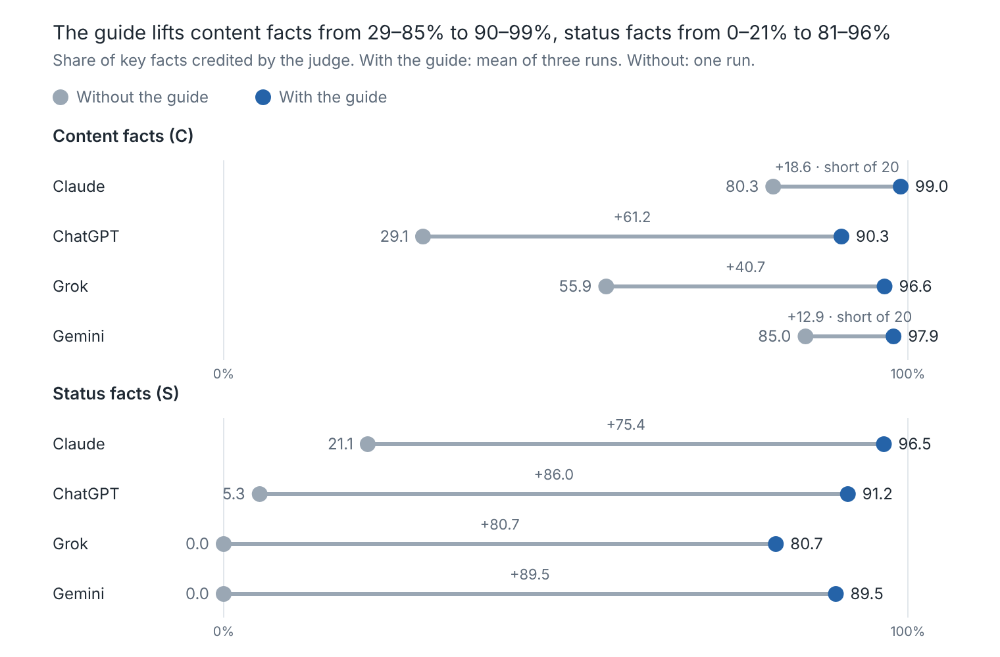
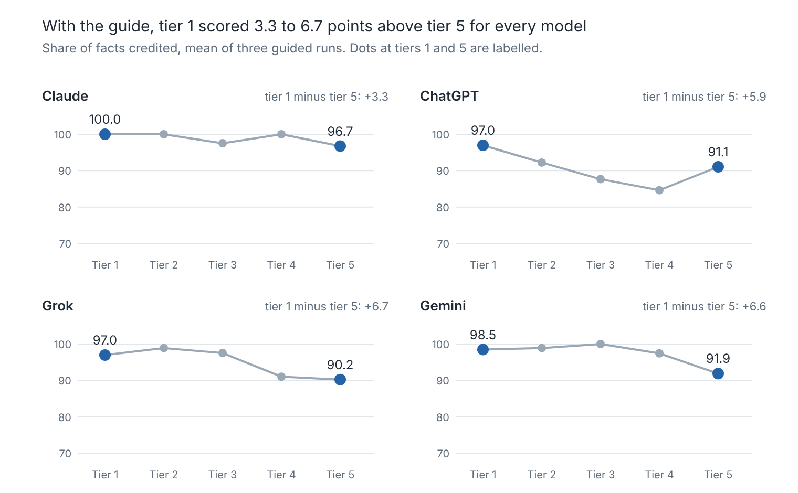
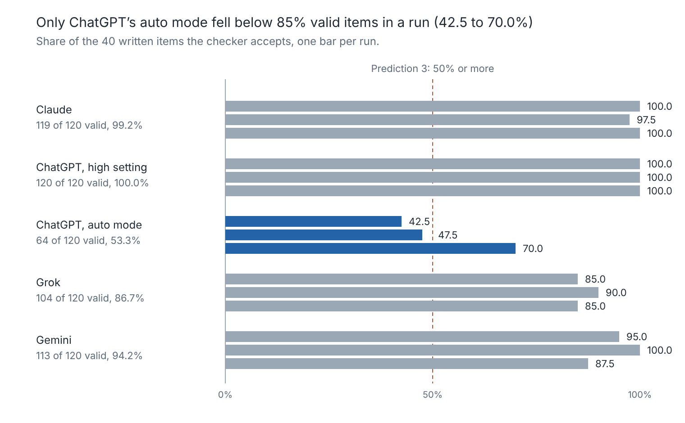
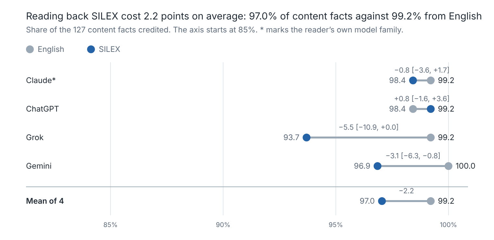
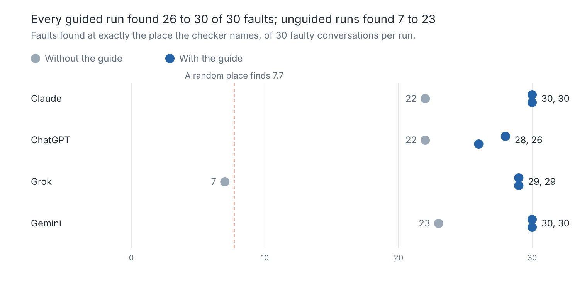
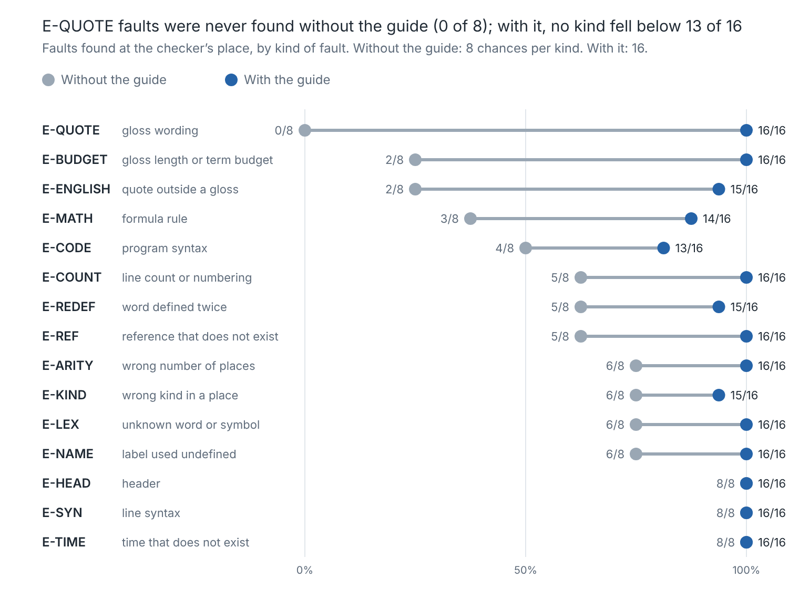

# SILEX-0 blind test: results report

Nov 14, 2026

> Note on this public copy. This is the report from the runner's Claude Doc, revision 20, 14 November 2026. The text, tables and numbers are unchanged. The six charts are redrawn from the data inside the document, and the byline is left out. Where the report says "the repository", it means the private repository that holds the frozen kits and the answer keys. That repository stays private for now so that the keys are not published. This public package holds the tables, protocol, tools and file fingerprints (see README.md). The three tools marked "not yet" in the reproducibility table are in this package under tools/.

## Summary

With the guide, all four models recovered 90 to 99% of the content facts in 40 SILEX-0 items; without it they recovered 29 to 85%. On the 19 status facts that only the guide's rules give, the gap is larger: 81 to 96% with the guide, 0 to 21% without. The predictions fixed before any chat held as follows: predictions 2 and 3 for every model, prediction 1 (a gain of at least 20 points from the guide) for ChatGPT and Grok only.

| Model | Prediction 1: gain from the guide on content facts (needs 20 points or more) | Prediction 2: tier 1 minus tier 5, with the guide (needs above 0) | Prediction 3: written items that pass the checker (needs 50% or more) |
| --- | --- | --- | --- |
| Claude | +18.6 points: no | +3.3 points: yes | 99.2%: yes |
| ChatGPT | +61.2 points: yes | +5.9 points: yes | 100.0% at its high setting, 53.3% in auto mode: yes |
| Grok | +40.7 points: yes | +6.7 points: yes | 86.7%: yes |
| Gemini | +12.9 points: no | +6.6 points: yes | 94.2%: yes |

No prediction was made for the rest, which is reported as found:

- Round trip: a Claude reader recovered 97.0% of the content facts from SILEX written by the four models, against 99.2% from their English (minus 2.2 points).
- Length: the models' SILEX is as long as the gold SILEX, and 31 to 41% shorter than their own English for the same scenarios.
- Find the fault: with the guide the models located the planted fault in 232 of 240 faulty conversations (97%) and raised no false alarm; without it they found 74 of 120 (62%).

Three things not to over-read:

1. Differences between models are descriptive. Thinking mode and model tier were not controlled, and Gemini's three writing runs used three different models.
2. The 20-point threshold of prediction 1 could not be reached by a model that already scored above 80% without the guide (Claude 80.3%, Gemini 85.0%). Each model had one no-guide run.
3. Claude wrote the items and is one of the four tested models; Claude also read every round-trip chat, and every judge is a Claude model. The first judge credited slightly more than the second judge and than the runner's audit.

The runner's own readings of these results, and what the data say about them, have a section of their own; none of them was tested directly.

## What was tested and how

Four AI models that had never seen SILEX-0 were asked to read it, write it and find faults in it. Every task ran in a fresh temporary chat with memory, search and tools off where the app has a switch. The packets also told the model not to search or run code.

The material is 40 fixed items, each a short SILEX-0 conversation with an English scenario. They carry 146 key facts: 127 content facts (C) and 19 status facts (S). Status facts, such as whether a word is pinned, come only from the guide's rules.

The items fall into five tiers of eight. Tier 1 holds basic features (headers, questions, logic, probability, requests). Tier 5 holds advanced ones (nested logic, formulas, colliding definitions, review of a held message).

| Arm | Task | Guide | Chats | Scored by |
| --- | --- | --- | --- | --- |
| R | Read the 40 items and say what each means | yes | 3 per model | Judge agent, fact by fact |
| N | The same reading task | no | 1 per model | Judge agent, fact by fact |
| P | Write each of the 40 scenarios in SILEX-0 | yes | 3 per model (ChatGPT: 6) | The guide's checker, form only |
| RTP | A Claude reader restates each writer's SILEX | yes | 1 per writer | Judge agent, content facts |
| E | Write the same scenarios in plain English | no | 1 per model | Length only |
| RTE | A Claude reader restates each writer's English | no | 1 per writer | Judge agent, content facts |
| FR | Find the one planted fault in each of 40 conversations, or answer none | yes | 2 per model | Program (place), judge agent (phrase) |
| FN | The same fault-finding task | no | 1 per model | Program (place), judge agent (phrase) |

In Test F, 30 of the 40 conversations hold one planted fault, two for each of the 15 verdicts of the guide's checker. The other 10 are clean. The checker, not the author, decides where each fault is.

One person, the runner, pasted every packet into the apps and every reply back as given. Claude wrote the items and the key and is one of the four models tested. The checker is the runner's own program and judges form, not truth.

Four predictions were written down before the first main run:

1. With the guide, each model recovers at least 20 points more of the C facts than without it.
2. With the guide, each model scores higher on tier 1 than on tier 5.
3. At least half of each model's written items pass the checker.
4. No prediction for length or for the round trip against English; both are reported as found.

Test F was added at 23:22 IST on 13 November, before any of its chats, and carries no prediction. Judges scored facts 1 or 0 from fact lists and explanations only, shuffled and without model, run or arm. Intervals are 95% bootstrap intervals over the 40 items; no significance tests were run.

Settings are as the runner stated them and are listed in the appendix. Claude ran Sonnet 5.5 and Grok ran 4.7, each at one setting throughout. ChatGPT and Gemini changed model or setting between tests.

Thinking mode and model tier were not controlled, so differences between models are descriptive. Contrasts within one model, such as R minus N, are fair.

## Reading with and without the guide

With the guide, the four models credited 90.3 to 99.0% of the content facts; without it, 29.1 to 85.0%.

*First-judge scores · tools/aggregate.py on scores_long.csv · 4 models, 40 items, 146 facts (127 C, 19 S)*

Prediction 1 asked for a gain of at least 20 points on content facts. ChatGPT (+61.2) and Grok (+40.7) met it; Claude (+18.6) and Gemini (+12.9) did not.

Claude and Gemini already read 80.3% and 85.0% without the guide. Their largest possible gains were 19.7 and 15.0 points, so the threshold ignored headroom.

Status facts show the guide's effect most clearly: 0.0 to 21.1% credited without it, 80.7 to 96.5% with it. The no-guide prompt does not cue the status words, so part of that gap comes from the prompt and not only from the guide.

Each guided figure is a mean of three runs. A model's lowest and highest guided run on content facts are 2.4 points apart for Claude, 3.9 for Grok, 6.3 for Gemini and 20.4 for ChatGPT, whose third run scored 78.0%.

False statements were rare with the guide (0.0 to 2.0 per 20 items). Without it Grok made 14.0 per 20 items; the other three made 2.0 to 3.5.

Prediction 2 held on the point estimates: with the guide, tier 1 scored above tier 5 for all four models.

*First-judge scores, arm R · tools/aggregate.py on scores_long.csv · 22, 30, 27, 26 and 41 facts per run in tiers 1 to 5*

The gaps are 3.3 to 6.7 points, over 22 facts in tier 1 and 41 in tier 5. The 95% intervals exclude zero for Claude (+0.7 to +6.2) and Gemini (+1.8 to +10.6) but not for ChatGPT (−4.4 to +17.9) or Grok (−1.5 to +14.3).

The tiers in between do not fall steadily: ChatGPT scored lowest on tier 4 (84.6%), and Gemini scored 100.0% on tier 3. Without the guide tier does not order the scores either: ChatGPT credited 9.1% of tier 1 and 43.9% of tier 5.

Each model had one no-guide run, so those figures show no run-to-run spread, and the intervals cover only the choice of items. ChatGPT's reading chats ran in auto mode, whose thinking effort could not be set.

## Writing: do the written items pass the checker?

Prediction 3 held for every model: 86.7 to 100.0% of written items passed the checker, and 53.3% for ChatGPT in auto mode.

*Checker validity, 15 runs of 40 items · tools/aggregate.py, table writing_by_run.csv · ChatGPT main set = runs 4 to 6*

An item is valid only if the checker says ok to every message in it. NONE, a missing item, a comment or any verdict makes it invalid. The writers could not run the checker, so the score shows how well each model applies the guide without one.

ChatGPT ran twice. In auto mode (runs 1 to 3) 53.3% of its items were valid (95% interval 40.8 to 66.7); at Astra 6 medium, its highest setting, all 120 were. That rerun was decided after the auto results were seen, and both sets stay in the data.

Gemini's three runs used three models: 3.1 Pro wrote 95.0% valid items, 4 Argon 100.0% and 3.5 Flash-lite 87.5%.

Of the 600 items written in all 15 runs, 80 were invalid: 75 with checker verdicts and 5 NONE, all in ChatGPT's auto mode. E-LEX, an unknown symbol or a word that is not in scope, makes up 86 of the 121 verdicts. Wrong kinds (E-KIND, 12) and bad references (E-REF, 9) follow.

Four items failed in at least 4 of the 12 main-set runs: #17 (a review of a message held as text), #18 (a word flagged, retracted, replaced and agreed), #31 (a program and its printed value) and #35 (pinned status: silence is not agreement). Grok's weakest tier was tier 5, at 50.0% valid, where Claude, ChatGPT and Gemini scored 95.8, 100.0 and 91.7%.

## Round trip: SILEX against English

A Claude reader recovered 97.0% of the content facts from the four models' SILEX and 99.2% from their English, a difference of 2.2 points.

*First-judge scores on the scenarios' content facts · tools/aggregate.py, table roundtrip.csv · intervals: paired bootstrap over the 40 items, 10,000 resamples*

The same reader, Claude Sonnet 5.5 at Extra, restated each writer's SILEX and each writer's English in eight fresh chats. The SILEX reader had the guide and the English reader did not. A judge scored each scenario's 127 content facts against the restatement.

The paired 95% intervals include zero for Claude and ChatGPT and exclude it for Gemini (−6.3 to −0.8); Grok's ends at +0.0. Without Claude, the reader's own model family, the mean difference is −2.6 points (SILEX 96.6%, English 99.2%).

For Grok the shortfall comes from invalid items. On the 34 items valid in its SILEX source run, SILEX scored 100.0% against 99.0% for English (+1.0, interval 0.0 to +3.2). Gemini's gap narrows but stays on its 38 valid items (97.5% against 100.0%, −2.5, interval −5.6 to 0.0).

By tier, SILEX trails English most in tier 3, where Claude, Grok and Gemini each lose two of 23 facts, and for Grok in tier 5 (five of 35). The SILEX each reader saw came from one run per writer: Claude run 1, ChatGPT run 4 (its high setting), Grok run 1 and Gemini run 1 (3.1 Pro). One reader makes the writers comparable with each other, not with other readers.

## Length: SILEX against the gold items and against English

The models' SILEX is as long as the gold SILEX and 31 to 41% shorter than their own English for the same scenarios.

| Writer | SILEX median (characters per item) | English median (characters per item) | English length against gold SILEX (median ratio) | SILEX characters per English character (median) |
| --- | --- | --- | --- | --- |
| Claude | 71.0 | 102.5 | 1.46 | 0.69 |
| ChatGPT | 72.0 (auto mode: 76.0) | 105.0 | 1.57 | 0.63 |
| Grok | 73.5 | 131.0 | 1.64 | 0.63 |
| Gemini | 71.5 | 125.0 | 1.73 | 0.59 |

The gold items have a median of 69.0 characters. The median item-wise ratio of a writer's SILEX to the gold SILEX is 1.00 for every main set and 1.03 for ChatGPT's auto mode.

SILEX medians cover each writer's three main runs; the last column uses the round-trip source run. The two forms are counted slightly differently (SILEX: block text without comments; English: the text after the item number), so the comparison is descriptive. The English is the models' own short English for the same scenarios: a reference point, not a ceiling.

## Test F: finding a planted fault

With the guide, models located the planted fault in 232 of 240 faulty conversations (97%) and raised no false alarm. Without it they found 74 of 120 (62%).

*tools/score_f.py on the 12 filed replies · place found = exactly the checker's place · baseline from README_F.txt*

A random place would find 7.7 of 30 (26%) and raise a false alarm on every clean item; answering none finds nothing. Every guided run found 26 to 30 of 30. Unguided, Claude and ChatGPT found 22, Gemini 23 and Grok 7.

Grok without the guide answered none on 23 of the 30 faulty items, so its low score is missed faults, not wrong places; it raised no false alarm. Gemini raised the only false alarm of the test, on 1 of 10 clean items.

*tools/score_f.py, table by verdict · two faulty conversations per kind per run, so for description only*

Without the guide, faults that only the guide's rules define went unseen: E-QUOTE 0 of 8, E-BUDGET and E-ENGLISH 2 of 8. Headers, line syntax and impossible times were found every time by every model. Two faults per kind per run make these counts descriptive only.

Four items were found by no unguided run: two E-QUOTE, one E-MATH and one E-BUDGET. Every item was found by at least one guided run.

| Arm | Runs | Place found (of 30 faulty) | False alarms (of 10 clean) | Fault detected | Phrase credited, of answers naming a fault | Phrase credited, of all 30 faulty |
| --- | --- | --- | --- | --- | --- | --- |
| With the guide (FR) | 8 | 232 of 240 (97%) | 0 of 80 | 233 of 240 (97%) | 228 of 233 (98%) | 228 of 240 (95%) |
| Without the guide (FN) | 4 | 74 of 120 (62%) | 1 of 40 | 77 of 120 (64%) | 68 of 77 (88%) | 68 of 120 (57%) |

The Wilson 95% intervals for the place score are 94 to 98% guided and 53 to 70% unguided. They treat the runs as independent, which they are not, so read them as orientation. Test F carried no pre-registered prediction.

A blind judge scored whether each answer's phrase names the key's fault. Of the answers with the right place, 228 of 232 guided and 68 of 74 unguided had a credited phrase; none of the 4 answers with a wrong place did. That judge ran once, on Claude Fable 5.2 agents, and by the runner's decision no second judge or audit checked it, so the phrase scores have no reliability check.

ChatGPT wrote its 20 answers of each batch on one line in all six of its Test F replies; the runner confirmed this is its own output. The primary score reads a line with several item codes as several answers.

Under the strict reading of the README, where only the first answer on a line counts, ChatGPT would score 4 of 60 guided and 2 of 30 unguided. Pooled results would fall to 76% guided and 45% unguided; the other models are unchanged.

## The runner's readings, and what the data say about them

The runner draws three readings from these results; the data bear on two of them, and none was tested directly.

| Reading (the runner, 14 November) | What the data show | What the data cannot show |
| --- | --- | --- |
| An advanced model needs very short training to grasp the concept and design, because some stronger models can predict about 80% of the language from their trained knowledge. | Without the guide, Claude credited 80.3% and Gemini 85.0% of the content facts, with 3.5 and 2.5 false statements per 20 items. Grok credited 55.9% and ChatGPT 29.1%. With the guide all four credited 90.3 to 99.0%. | Training length was not varied: no arm sat between no guide and the full guide. Trained knowledge cannot be told from inference across the 20 items of a packet. The no-guide arm measures reading, not predicting the language, and status facts stayed at 0 to 21% without the guide. |
| Weaker models may not be as efficient in learning SILEX. | The two models lowest without the guide gained most from it (ChatGPT +61.2, Grok +40.7 points) and stayed lowest with it on content facts (90.3% and 96.6%, against 97.9% and 99.0%). ChatGPT wrote 53.3% valid items in auto mode and 100.0% at its highest setting; without the guide at that setting it found 22 of 30 faults in Test F, as Claude did. | Model strength was not measured or controlled; thinking mode and tier differed. Whether Astra 6 and 6.0 sol are one model is open. ChatGPT's reading chats ran only in auto mode. |
| SILEX is pointed towards the next generations of superintelligence. | Nothing: this is a statement of purpose. | The tests used four models of November 2026, 40 items and form-level checks. They say nothing about future systems. |

Two added tests would bear on the first two readings. A graded-primer arm would give models excerpts of the guide of increasing length and show how little text recovers most of the content. A size ladder within one model family at a fixed thinking setting would separate model strength from setting.

## How the scoring was kept honest

Both reliability checks stayed under the 10% bar fixed before judging, so the first judge's scores are the primary results.

Separate agents judged, blind to model, run and arm. The first judge was eight cold-start agents on Claude Fable 5.2, six sheets each: 32 reading and 16 round-trip sheets. The second judge was three agents on Claude Opus 5.5 that re-scored a random 20% of the explanations (192 of 960, on 17 sheets).

Each sheet held a random four-character code, a fact list and explanations, nothing more. The sheet builders found no explanation that names a model. ChatGPT's app status line ("Worked for 27s") sat outside the items in the reading parses and reached no judge.

A program read every agent's transcript after it finished. Each agent had only read its own sheets, written its own replies and run on the model named for its pass. No group was run again, and every reply passed the form check.

Before the first real sheet, one agent judged a made-up sheet with a known answer. It credited all 37 facts of ten untouched explanations and none of the 43 facts of ten explanations swapped in from other items.

| Check | Facts compared | Differing | Share | Bar for a full re-judge |
| --- | --- | --- | --- | --- |
| Second judge, reading arms | 476 | 20 | 4.2% | above 10% |
| Second judge, round trip | 214 | 3 | 1.4% | above 10% |
| Second judge, all | 690 | 23 | 3.3% | above 10% |
| Runner's audit | 30 | 2 | 6.7% | 4 or more of 30 |

The audit drew 30 facts at random from all 3,352 judged facts. The runner saw only the fact and the explanation, not the judge's score. Cohen's kappa between the two judges, agreement beyond chance, is 0.837.

The differences lean one way. In 20 of the 23 second-judge differences the first judge credited a fact the second did not. In both audit differences it credited a fact the runner did not.

In guided reading the second judge credited 14 fewer facts than the first (3.7 points of 380). It credited 3 fewer in the round trip (1.4 points of 214) and the same number without the guide (96 facts). So the first judge is slightly generous, and the guide's gain in reading could be a little overstated.

Eleven of the 23 differences sit on two items, #17 and #28. Claude saw the list of the 23 differing facts and the 2 differing audit entries before the aggregate ran, printed by the pre-agreed comparison tools. It saw no total or table by condition.

The order of steps, in IST:

1. 13 Nov: a one-chat Claude pilot, not in the data, led to one kit rebuild. The Test F kit was frozen at 23:22.
2. 13 Nov 13:50 to 14 Nov 02:05: all 32 reading replies were filed.
3. 14 Nov 02:38 and 02:50: the frozen kits and the protocol document were committed to a private repository.
4. 14 Nov 05:59 and 06:24: the analysis plan, the aggregator and the judging procedure were fixed, before any judge sheet existed.
5. 14 Nov 18:53: the runner said all chats were done. Hashes and tests were checked before the first sheet.
6. 14 Nov 19:00 to 19:43: judging, audit, second judge and aggregate, then the Test F scores.

The commit that timestamps the predictions came after the reading chats and before the writing, English, round-trip and Test F chats. It shows that nothing changed from then on. That the predictions preceded the first chat rests on the runner's account.

The protocol first named Claude as the single judge. The runner chose separate agents on 14 November at 06:06, before any judge sheet existed. The Test F program score waited until the judged results and both reliability checks were in, and was run once.

Each guided chat began with a check question (STEP 2) that only the guide can answer. The log records no wrong answer.

Blinding has limits. A reply's style can show its arm, such as a hedging answer without the guide. Every judge is a Claude model, Claude wrote the items and the key, and Claude is one of the four models tested.

The second judge and the audit guard against a Claude preference but cannot rule it out. The Test F phrase scores, from three Claude Fable 5.2 agents, had no second judge or audit, by the runner's decision. The Test F place score is computed by a program from the checker's key and needs no judge.

## Limits of these results

These results are a descriptive first look at four models on 40 items by one author; they do not rank the models or show that SILEX works beyond this material.

On these items every model read SILEX-0 better with the guide, wrote at least half of its items valid, and found planted faults far more often with it. The results cannot say how the models rank in strength, how SILEX behaves on other material, or how it would fare with other systems.

On the design:

- One author. Claude wrote the items and the key and is one of the four models tested.
- Forty items in one fixed order, two batches per chat. Item, order and chat effects cannot be separated.
- Few runs. Each model has three guided and one unguided reading run, three writing runs (six for ChatGPT) and three Test F chats. The unguided runs show no run-to-run spread.
- Test F reuses the reading material: its 10 clean items and 25 of its faulty ones are reading conversations, and 5 faulty ones are new. Chats were fresh, but the tests are not independent.
- Form, not truth. The checker and the judges test whether a message is well formed and an explanation matches the key, not whether a statement is true or wise.

On the models and settings:

- Thinking mode and model tier were not controlled. ChatGPT's reading chats ran in auto mode only, and Gemini's three writing runs used three models.
- Whether ChatGPT's Astra 6 and 6.0 sol are one model is open. Beyond the names the runner gave, no versions were recorded.
- Test F chats ran model by model, not in the balanced order its README suggested, so order and model are confounded.
- All six ChatGPT Test F replies put 20 answers on one line. The primary score reads them by item code; the strict reading is a side note.
- The apps were run by hand and Claude could not inspect their settings. The Claude app has no search switch, so the packets carried a no-search line; no reply was flagged for search-like words. Some ChatGPT replies carry an app line, "Worked for N s", that may mean thinking time or tool use.

On judging and prior knowledge:

- One Claude reader, Sonnet 5.5 at Extra, restated every round-trip chat. It is of the same family as the Claude writer and as the judges, and each writer contributed one source run.
- The no-guide reading prompt does not cue the status words, so part of the status-fact gap comes from the prompt.
- The Test F phrase scores have no reliability check.
- The leak checks are self-reports. Each model said in a fresh chat that it did not know SILEX; Claude's first check ran with web search on and found nothing, so its second check is the official one. A self-report cannot show what a model infers from similar constructed languages, and the unguided scores include such inference.

The results describe four models as they were in November 2026. Three of the tools' own tests fail on stale expectations, listed in the appendix.

## Reproducibility

The rules, plans and scoring tools were hashed before the steps that used them, so every table in this report traces to a fixed file.

| File | Fixed (IST, 14 Nov unless stated) | Fingerprint | In the repository |
| --- | --- | --- | --- |
| Guide SILEX-0-GRAMMAR.md, edition 0.14s | in the frozen reading kit | SHA-256 fd8640fcec49787e | yes |
| Reading kit and Test F kit | 02:38 (Test F kit frozen 13 Nov, 23:22) | commit f0e608b0 | yes |
| Protocol document, rev 20 | 02:50 | commit 34a39562 | yes |
| ANALYSIS_PLAN.md | 05:59 | SHA-256 25e27eeac34a1f4a | yes |
| tools/aggregate.py | 05:59 | SHA-256 0c2ec37a4cfee7b6 | yes |
| JUDGING_PROCEDURE.md | 06:24 | SHA-256 bf56e21fe4f0a6b4 | yes |
| tools/score_f.py | frozen in the Test F kit | SHA-256 fe01189f2c43d6d4 | yes |
| tools/make_strict_copy_f.py | 19:05 | SHA-256 4c2da5a40c99c415 | not yet |
| tools/phrase_judge_f.py | 19:16 | SHA-256 7fff8c2c82adef89 | not yet |
| tools/fill_scoring_xlsx.py | 19:39, logged when it ran | SHA-256 dfdc0e6f79592b2a | not yet |

Hashes are the first 16 characters of SHA-256. The three tools marked "not yet" were written after the last commit; their hashes are in the log, and they go into the repository when the runner asks for an update.

Seeds were written in the log before each draw. The sheet builders used 20261114301 (reading) and 20261114302 (round trip), the first-judge staging 20261114303, the second-judge draw and staging 20261114304 and 20261114305, and the audit draw 20261114306. The Test F phrase sheets used 20261114307 and 20261114308, and bootstrap intervals use numpy default_rng(\[20261114, k\]) with 10,000 resamples.

Eight test suites pass in full: test_f_tools (65 checks), test_e_tools (132), test_rt_tools (46), test_judging_stage (67), test_judging_tools (16), test_reliability (61), test_aggregate (281) and test_phrase_judge_f (55). Three older suites each fail one check that is a stale expectation of the test, not a fault of the tool; the appendix lists them. The kit's scoring workbook, filled from the aggregator's scores and recalculated by LibreOffice, matched the aggregator's tables on all 188 numbers.

The repository is private, as checked through GitHub's API on 14 November, and its last commit (18:56 IST) came before any judge sheet existed. It holds the frozen kits, the protocol, the rules, the tools and the round-trip packets. It holds no replies from the study and no scores, and the round-trip keys appear only as hashes.

The replies, parses, judge sheets, judge replies, sheet maps and keys are in the runner's results and judging folders. An archive of both, made on 14 November after all results existed and sent to the runner, has 1,507 files and SHA-256 51f4d9d8f0467668.

To re-make the tables, run tools/aggregate.py on the judge replies with the private sheet maps and keys. To re-score Test F, run tools/score_f.py on the filed replies and the key.

Opening the repository would also publish the answer keys, because the frozen kits include them. A later blind test on new models would then need new items.

## Appendix: models, settings and decisions

This appendix lists the models and settings as the runner stated them, every decision made after the freeze, and the known test failures.

| Test | Claude | ChatGPT | Grok | Gemini |
| --- | --- | --- | --- | --- |
| Reading (R, N) | Sonnet 5.5, Extra | 6.0 sol, auto | 4.7, heavy | 4 Argon |
| Writing (P) | Sonnet 5.5, Extra | runs 1 to 3: 6.0 sol, auto; runs 4 to 6: Astra 6, medium | 4.7, heavy | run 1: 3.1 Pro; run 2: 4 Argon; run 3: 3.5 Flash-lite |
| English baseline (E) | Sonnet 5.5, Extra | Astra 6, medium | 4.7, heavy | 3.1 Pro |
| Test F (FR, FN) | Sonnet 5.5, Extra | Astra 6, medium | 4.7, heavy | 3.1 Pro |

The round-trip readers were Claude Sonnet 5.5 at Extra in all eight chats. "Medium" is the highest thinking setting the runner's subscription offers for Astra 6, and ChatGPT in auto mode has no setting to adjust. Gemini's thinking setting was not stated, and model versions were not given for the leak checks.

In the writing, guided round-trip and guided Test F chats the guide was attached as a file, as the runner stated. How it was given is not stated for every reading chat.

Decisions made after the freeze, in order:

| When (IST) | Decision | Effect |
| --- | --- | --- |
| 13 Nov | A one-chat Claude pilot led to one kit rebuild: items #04, #08 and #27 reworded, the reading headers, a no-search line in the leak check, a reader-prompt file. | The pilot reply is not in the data. |
| 13 Nov, 23:22 | Test F kit frozen, before any F chat. | Test F has no prediction. |
| 14 Nov, 02:38 | Frozen kits and protocol document committed to a private repository. | The timestamp is later than the reading chats. |
| 14 Nov, 05:04 | ChatGPT's writing test repeated at its highest setting, after the auto results were seen. ChatGPT then ran at that setting in every new test. | Both sets are reported; the high set is the main set. |
| 14 Nov, 05:09 | Gemini's three writing models kept as they were. | Pooled as pre-registered and shown by run. |
| 14 Nov, 06:06 | Round-trip reader fixed as Claude Sonnet 5.5 at Extra. The judge changed from Claude itself to separate agents. | The reader shares a family with the Claude writer; results are shown with and without it. |
| 14 Nov, 06:31 | A sentence of the round-trip rules that tied a reader chat to its writer was withdrawn. | The text stays in the commit history; no later file names the writer of a reader chat. |
| 14 Nov, 08:42 | English baseline: a line "#NN" followed by a message line starts an item, so one-line replies count. | ChatGPT's English items came one per line; their message-line counts are not used. |
| 14 Nov, 18:26 | Test F: a line with several item codes is read as several answers, for every model. | The strict reading is reported beside it. |
| 14 Nov, 19:14 and 19:40 | Test F phrase judge appointed: three Claude Fable 5.2 agents. The runner decided against a second judge. | The phrase scores have no reliability check. |

Also recorded: the Gemini English chat ran before the Grok one, an order not expected to matter.

Three older test suites each fail one check, and each failure is a stale expectation of the test, not a fault of the tool:

| Suite | Passed | Failed | Why the failing check is stale |
| --- | --- | --- | --- |
| test_p_tools | 73 | 1 | It expects the results folder to hold no writing-test files such as cells_P.csv; they exist now. |
| test_roundtrip_p | 87 | 1 | It expects a writer run without a data reply to stop the build; every writer run has one now. |
| test_intake | 20 | 1 | It expects one reading sheet per row of cells.csv; the file now also holds 16 round-trip rows, and the builder builds only arms R and N. |

A diagnostic build in a scratch folder gave the expected 32 reading sheets: 4 models, each with 3 guided and 1 unguided run, in 2 batches.
